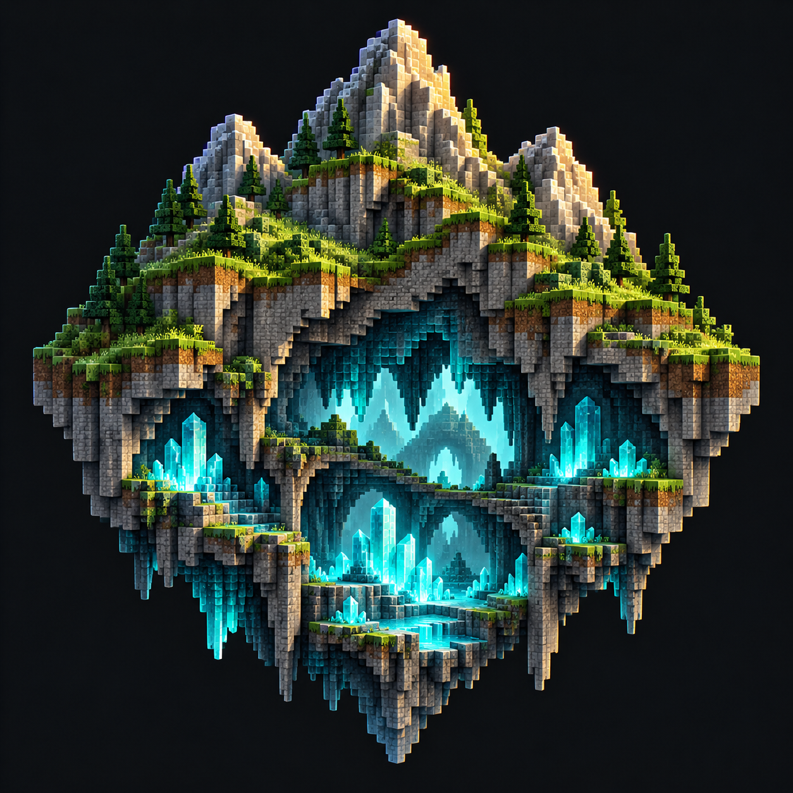

<p align="center"></p>

# Terraforged Alex's Caves Fix

**Keep UltraTerraForged's landscapes. Bring Alex's Caves underground.**

A focused compatibility add-on for **Minecraft 1.21.1 / NeoForge**. Adapts Alex's Caves biome placement to UltraTerraForged, restores native cave chamber placement, protects cave biomes from additional carving, and checks `/locateacbiome` destinations against the active biome source.

**[Download 1.0.0](downloads/terraforged-alexs-caves-fix-1.0.0-neoforge-1.21.1.jar?raw=true)** · **[Report a bug](https://github.com/Mikaaah/Terraforged-Alexs-Caves-Fix/issues/new/choose)** · **[Validation](VALIDATION.md)**

## What it fixes

- **Missing cave biomes:** adapts the port's original depth and inland/ocean filters to UltraTerraForged terrain. Custom ranges, rarity settings, disabled biomes, spawn exclusions, and dimension restrictions remain respected.
- **Rejected cave chambers:** stops UltraTerraForged's surface-structure river restriction from vetoing Alex's underground chamber generators. Their native candidate placement and matching-biome checks remain in place.
- **Extra carving through cave areas:** protects the six tagged Alex's Caves biomes from UltraTerraForged's additional carving, lining, and decorative block writes. Base noise caves still generate.
- **Misleading locator results:** verifies `/locateacbiome` candidates against the active biome source and suggests a teleport with an underground Y coordinate.

Supports **Magnetic Caves, Primordial Caves, Toxic Caves, Abyssal Chasm, Forlorn Hollows, and Candy Cavity**.

## Required versions

Version 1.0.0 deliberately targets this combination:

| Component | Version |
| --- | --- |
| Minecraft | 1.21.1 |
| Loader | NeoForge 21.1.219 or newer within 21.1.x |
| Java | 21 |
| UltraTerraForged | 1.0.2+1.21.1 |
| Alex's Caves unofficial NeoForge port | 2.0.10, by Raguto |
| Citadel unofficial port | Required by Alex's Caves; 2.7.6 used in testing |

Install on the **client and server**. Singleplayer uses the same installation. Other TerraForged forks and Alex's Caves builds are not supported by this release.

## Installation

1. Install the required mods and their dependencies.
2. Put the fix JAR in your instance's `mods` folder, and in the server's `mods` folder if applicable.
3. Create a world using the **UltraTerraForged** world type and your preferred terrain preset.
4. Keep **Generate Structures enabled** for Alex's native chamber structures.
5. Run `/tfacfix status` with operator permissions to check that the compatibility profile is active.

Use a new world for the clearest test. Previously saved chunks are not repaired; generation changes apply to new chunks. Back up an existing world before changing its world-generation mods or settings.

## Commands and configuration

```mcfunction
/tfacfix status
/locateacbiome primordial_caves
/locateacbiome magnetic_caves
```

The first launch creates `config/tfacfix-common.toml`. Placement, chamber placement, carving protection, and locator verification can each be toggled. The default cave-biome assignment band is Y -64 to 128, separate from the configurable noise-depth filter. Restart after changing world-generation settings.

This add-on does not rewrite the port's biome-generation JSON files. Broad manual edits are unnecessary with the original default filters; intentional custom ranges are still respected.

## Scope

The profile activates only for an active UltraTerraForged Overworld. Vanilla worlds, the Nether, and the End retain their normal sampler behavior.

This is a compatibility fix, not a terrain preset or a cave-size overhaul. It does not enlarge native chambers, regenerate existing chunks, protect complete structure bounding boxes, or add Streams Reflowing integration. A located cave biome can contain solid rock between native chambers; the locator verifies the biome, not a safe air pocket.

An **optional** [GenOne terrain preset](examples/GenOne.json) is included separately and is not installed automatically.

## Testing

Dedicated-server checks passed with the listed versions and TerraBlender 4.1.0.8: all six cave biomes were sampled, a native Magnetic Caves chamber and its chunk references were checked, locator commands and carving protection passed, and a vanilla-world control stayed inactive. Fourteen focused placement-rule checks also passed.

Client rendering, shaders, multiplayer client connections, and complete modpack compatibility have not been validated. See [VALIDATION.md](VALIDATION.md) and the recorded [test reports](validation).

## Build from source

Use JDK 21. Download the original mod files and place these in `libs/`:

```text
alexscaves-2.0.10.jar
ultraterraforged-1.0.2+1.21.1-neoforge.jar
```

Run `./gradlew build` (Linux/macOS) or `gradlew.bat build` (Windows). Artifacts appear in `build/libs/`. The optional `runtime-libs/` folder supplies Citadel and other dependencies for development server runs. Original dependency JARs are not redistributed here.

## Credits and license

An independent compatibility add-on by **Towns & Kingdoms**, not an official release by either original mod team.

- [UltraTerraForged](https://github.com/Pandaismyname1/ultraterraforged) by Pandaismyname1 and contributors.
- [Alex's Caves unofficial NeoForge port](https://github.com/Raguto/AlexsCaves-1.21.1) by Raguto and contributors; credit to the original Alex's Caves creators.
- [NeoForge tooling](https://github.com/NeoForgeMDKs/MDK-1.21.1-ModDevGradle).

**GPL-3.0-only** — see [LICENSE](LICENSE). Modpacks may include the add-on under that license.
